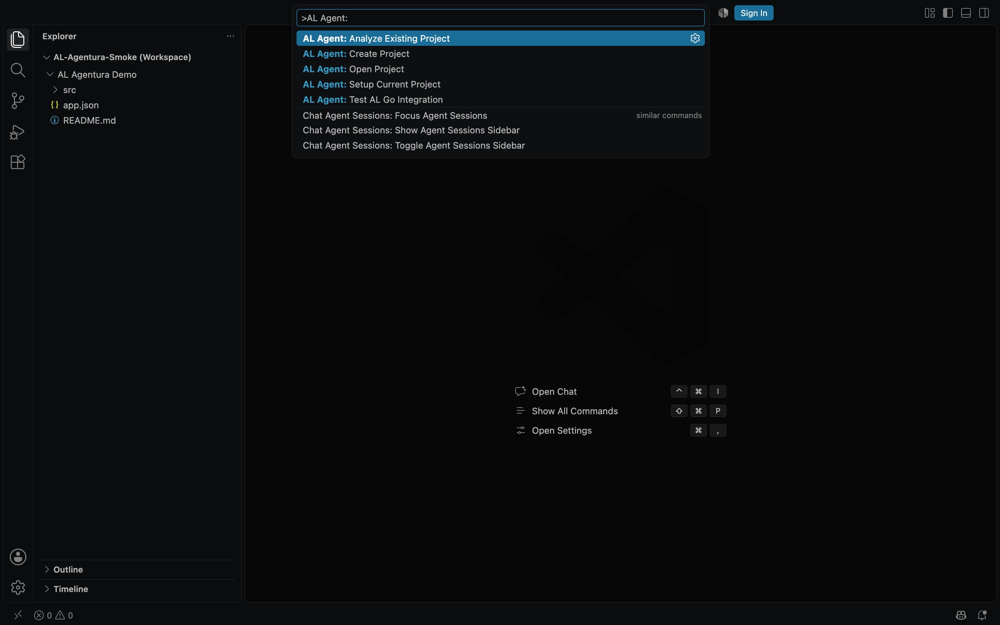
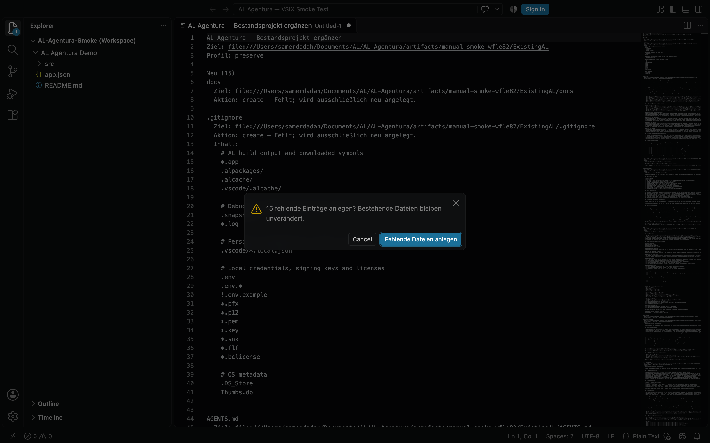
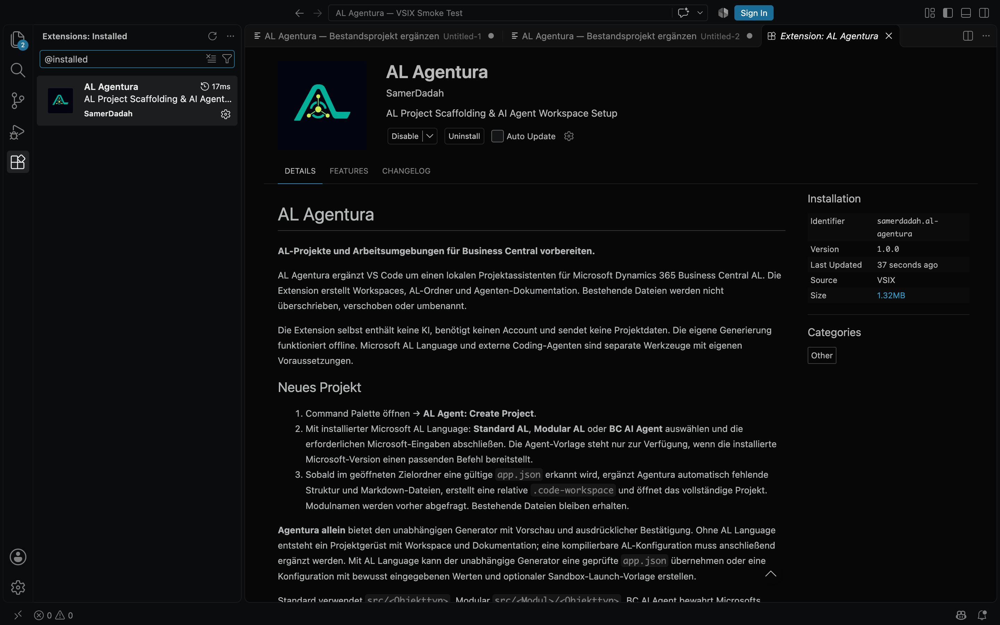

# AL Agentura

**AL-Projekte und Arbeitsumgebungen für Business Central vorbereiten.**

AL Agentura ergänzt VS Code um einen lokalen Projektassistenten für Microsoft Dynamics 365 Business Central AL. Die Extension erstellt Workspaces, AL-Ordner und Agenten-Dokumentation. Bestehende Dateien werden nicht überschrieben, verschoben oder umbenannt.

Die Extension selbst enthält keine KI, benötigt keinen Account und sendet keine Projektdaten. Die eigene Generierung funktioniert offline. Microsoft AL Language und externe Coding-Agenten sind separate Werkzeuge mit eigenen Voraussetzungen.

## Neues Projekt

1. Command Palette öffnen → **AL Agent: Create Project**.
2. Mit installierter Microsoft AL Language: **Standard AL**, **Modular AL** oder **BC AI Agent** auswählen und die erforderlichen Microsoft-Eingaben abschließen. Die Agent-Vorlage steht nur zur Verfügung, wenn die installierte Microsoft-Version einen passenden Befehl bereitstellt.
3. Sobald im geöffneten Zielordner eine gültige `app.json` erkannt wird, ergänzt Agentura automatisch fehlende Struktur und Markdown-Dateien, erstellt eine relative `.code-workspace` und öffnet das vollständige Projekt. Modulnamen werden vorher abgefragt. Bestehende Dateien bleiben erhalten.

**Agentura allein** bietet den unabhängigen Generator mit Vorschau und ausdrücklicher Bestätigung. Ohne AL Language entsteht ein Projektgerüst mit Workspace und Dokumentation; eine kompilierbare AL-Konfiguration muss anschließend ergänzt werden. Mit AL Language kann der unabhängige Generator eine geprüfte `app.json` übernehmen oder eine Konfiguration mit bewusst eingegebenen Werten und optionaler Sandbox-Launch-Vorlage erstellen.

Standard verwendet `src/<Objekttyp>`, Modular `src/<Modul>/<Objekttyp>`. BC AI Agent bewahrt Microsofts Projektstruktur und ergänzt Dokumentation sowie Workspace.

## Bestehendes Projekt ergänzen

1. Lokales AL-Projekt öffnen → **AL Agent: Setup Current Project**.
2. **Bestehende Struktur bewahren** wählen und gewünschte Modulgerüste auswählen. Zusätzliche Standard-/Modulordner werden nur auf ausdrückliche Auswahl angelegt.
3. Vorschau mit neuen Inhalten, vorhandenen Dateien und Konflikten prüfen → **Fehlende Dateien anlegen** bestätigen.

`docs/modules/INDEX.md` und `DISCOVERY.md` dokumentieren erkannte Pfade und Quellen. Ausgewählte Modulgerüste entstehen unter `docs/modules/details/`. Fachliche Inhalte bleiben **Zu prüfen**. `docs/GAPS.md` nennt Lücken; `AGENT_INITIALIZATION.md` enthält den kopierbaren Prompt für einen externen Agenten. Bestehende Dokumente bleiben unverändert. Ein weiterer Durchlauf erzeugt keine Duplikate.

## Weitere Befehle

- **AL Agent: Analyze Existing Project**: Struktur und Metadaten ausschließlich lesen. Bei mehreren Workspace-Roots wird der Zielordner ausgewählt.
- **AL Agent: Open Project**: einen Projektordner öffnen.
- **AL Agent: Test AL Go Integration**: optionaler Diagnoseaufruf; startet einen Microsoft-Befehl nur nach ausdrücklicher Bestätigung.

## Sicherheit und Grenzen

- Sicheres Schreiben unterstützt derzeit native lokale `file`-Ziele. Remote-/Virtual-Analyse und Planung bleiben möglich; dort wird die Anwendung vor Dateianlage verweigert. VS Code Desktop ab **1.90** ist erforderlich; keine Web-Extension.
- Abbruch vor Bestätigung verändert keine Projektdatei. Nach Zustimmung wird der Bestandsplan erneut geprüft. Konflikte oder veraltete Pläne stoppen die Anwendung. Teilfehler werden gemeldet; bereits angelegte Dateien werden nicht automatisch gelöscht.
- Im **Restricted Mode** bleiben Analyse und lokale Textvorlagen verfügbar. Externe Microsoft-Projektbefehle und deren Integrationstest sind deaktiviert. Agentura führt keine Workspace-Skripte, Templates als Code oder AL-Kompilierung aus.
- Microsofts Fertigstellung wird anhand eines einzelnen lokalen Workspace-Roots mit lesbarer `app.json` erkannt. Während eines offenen Microsoft-Ablaufs kein fremdes AL-Projekt öffnen. Bereits zuvor geöffnete AL-Projekte werden ausgeschlossen; ein vorher leerer Root darf von Microsoft befüllt werden. Die Fortsetzung läuft nach 15 Minuten ab. Bei stillem Microsoft-Abbruch oder nicht erkanntem Fensterwechsel **Setup Current Project** verwenden.
- Scangrenzen: 10.000 Einträge, 32 Verzeichnisebenen, 1 MiB `app.json`. `.git`, `node_modules` und AL-Paket-/Cacheverzeichnisse werden nicht betreten. Symlinks werden nicht verfolgt; unsichere Zielpfade blockieren.
- Keine automatische fachliche Codeerklärung, kein Compiler und keine garantierte automatische Erkennung der Markdown-Regeln durch einen Agenten. Einen konkreten Auftrag ausdrücklich auswählen und den Startprompt bewusst senden.

## Lokal aus VSIX installieren und testen

1. **Extensions → … → Install from VSIX…** öffnen, `al-agentura-1.0.1.vsix` auswählen und bei Aufforderung VS Code neu laden.
2. In Extensions **AL Agentura**, Version **1.0.1**, Publisher **SamerDadah** und das Logo prüfen. Eine ältere Entwicklungsfassung `local-development.al-agentura` vorher deaktivieren, damit keine doppelten Befehle registriert werden.
3. In einer Projektkopie **Create Project** und **Setup Current Project** testen. Abbruch muss vorhandene Dateien unverändert lassen; ein wiederholtes Setup darf keine Duplikate erzeugen.

Für einen getrennten Test ohne persönliche Einstellungen im Quellrepository `npm run smoke:manual` ausführen. Es installiert das vorhandene VSIX in ein frisches Profil und öffnet ausschließlich eine eigene Demo. Ein neuer Projektordner kann daneben unter `NewProjects` erstellt werden. Der Testordner liegt unter `artifacts/manual-smoke-*` und kann nach Schließen des Testfensters entfernt werden. Es wird kein Microsoft-/Sandbox-Kompiliererfolg behauptet.

## Einblicke

Echte Aufnahmen aus einer lokalen VSIX-Installation mit eigenen Demo-Dateien:

Beim Ergänzen eines Bestandsprojekts zeigt die Vorschau die geplanten Änderungen; bestehende Dateien bleiben erhalten.

Die installierte Erweiterung zeigt Publisher, Version und das AL-Agentura-Logo.

## Häufige Fehler

| Beobachtung | Prüfung / nächster Schritt |
|---|---|
| Befehle fehlen nach der Installation | Extensions-Ansicht auf Aktivierung prüfen, VS Code neu laden, alte `local-development`-Fassung deaktivieren. Unterstützt wird Desktop-VS-Code ab 1.90. |
| Microsoft-Projektbefehl nicht verfügbar | Microsoft AL Language installieren/aktivieren und einen vertrauenswürdigen Workspace verwenden. Die Agent-Vorlage muss von Microsofts installierter Version angeboten werden; sonst den eigenen Generator wählen. |
| Microsoft-Projekt wurde nicht automatisch ergänzt | Den tatsächlich erzeugten einzelnen lokalen Projektordner mit gültiger `app.json` öffnen; nach Ablauf der Fortsetzung **Setup Current Project** verwenden. |
| Vorschau meldet Konflikt oder veralteten Plan | Betroffene Pfade prüfen und Vorschau erneut erstellen. Dateien werden nicht automatisch ersetzt oder zusammengeführt. |
| Nur ein Gerüst, keine kompilierbare AL-App | Ohne AL Language entsteht bewusst keine erfundene AL-Konfiguration. Reale `app.json`, passende Symbole/AL Language und die eigene BC-Umgebung ergänzen. |
| Schreiben oder Öffnen schlägt fehl | Lokales beschreibbares Ziel ohne Symlink verwenden. Bei Teilfehlern vorhandene Dateien bewahren; den gemeldeten Workspace bei Bedarf manuell öffnen. |

## Fehler melden

Bei Fehlern die Benachrichtigung, den betroffenen Befehl, VS-Code-/AL-Language-Version und bereinigte Reproduktionsschritte über die [GitHub-Issues](https://github.com/samdadaa/al-agentura/issues) melden. Keine Projektarchive, Secrets, Tokens oder Kundendaten anhängen.

## Entwicklung

Node.js ab 22: `npm ci`, dann `npm run verify`. Der vollständige Lauf prüft Compile, Unit-Tests, echte isolierte VS-Code-Hosts, Restricted Mode, Paketinhalt und die Installation des fertigen VSIX. VS Code muss installiert sein; bei Bedarf `VSCODE_EXECUTABLE` setzen. Entwicklungs- und Release-Details liegen im Repository unter `docs/operations/` und `docs/quality/`.

## Lizenz

MIT — Copyright © 2026 Samer Dadah.
